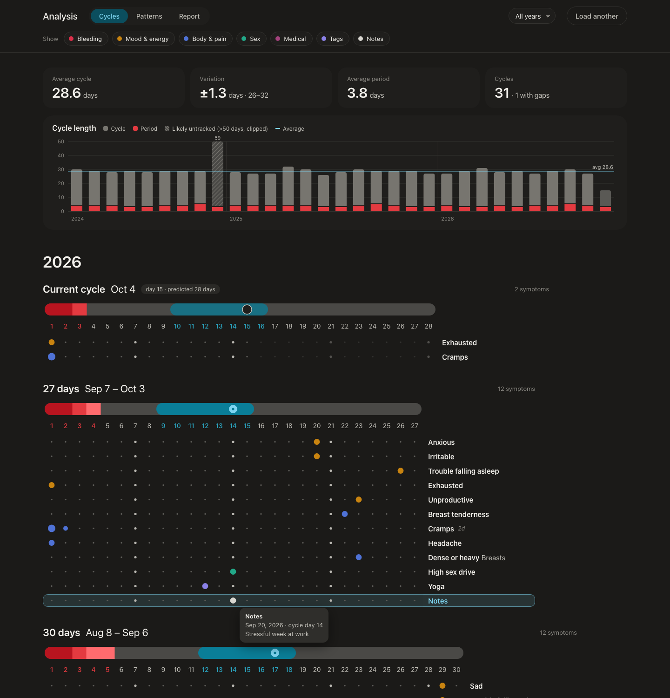
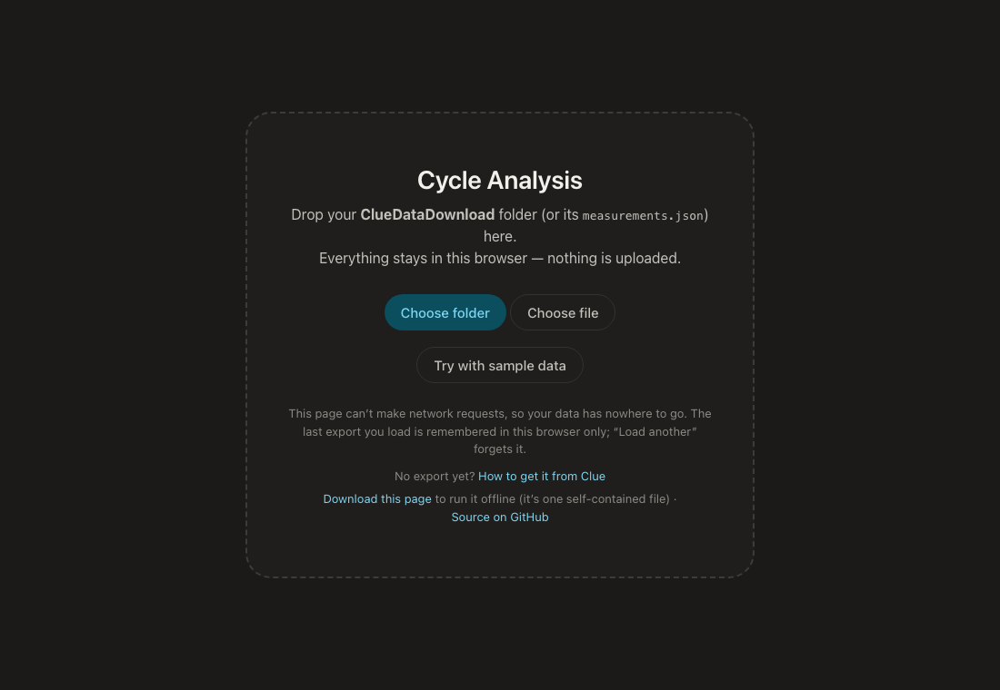
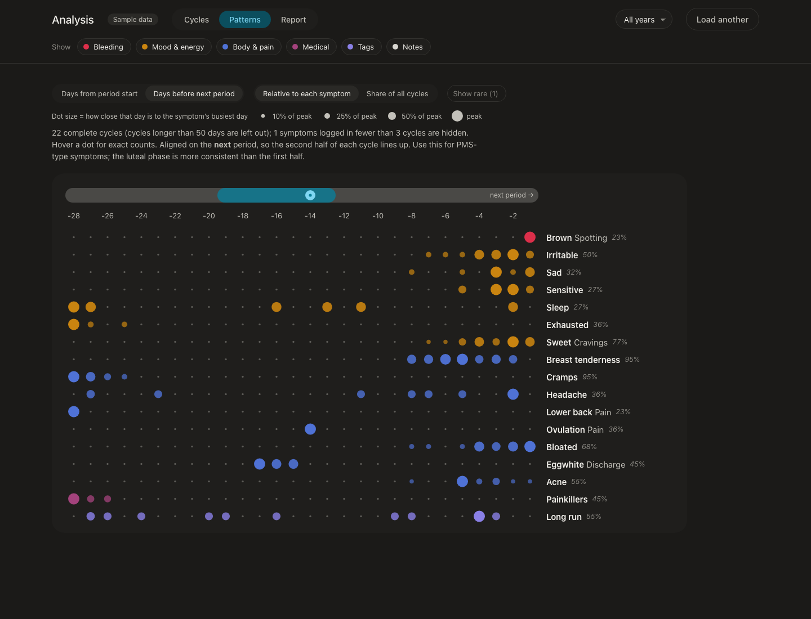
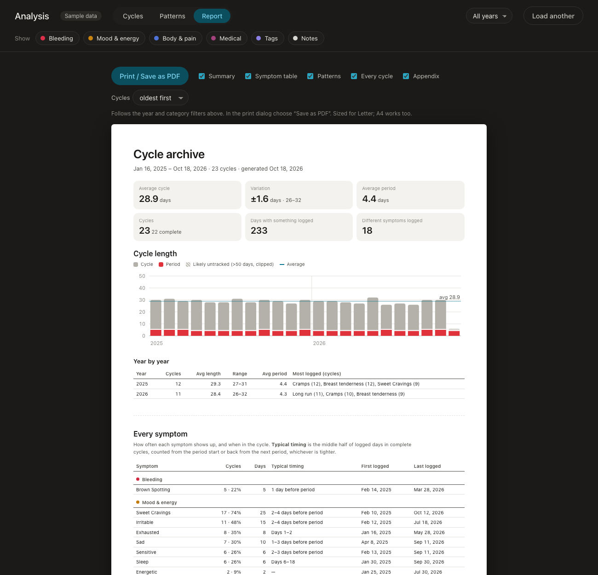

# Cycle export visualizer

A local, private viewer for the data export from the [Clue](https://helloclue.com) period tracking app. It shows every logged cycle in a dot-grid layout similar to Clue's Analysis screen, finds patterns across cycles, and prints a full archive to PDF.

**[Open it →](https://avandekleut.github.io/cycle-export-visualizer/)**  ·  or use **Download this page** on the start screen (or grab `index.html` here) and open it locally. It's one self-contained file and works offline.

> Not affiliated with or endorsed by Clue / BioWink GmbH.

## Your data stays in your browser

- The whole app is one static HTML file with no dependencies, no analytics and no server.
- A [Content-Security-Policy](index.html) blocks **all** network requests (`connect-src 'none'`), so the browser itself prevents the page from sending your export anywhere. You can check this in the page source.
- The last export you load is saved in your browser's local storage so a reload doesn't ask again. **Load another** clears it.

No export to hand? Click **Try with sample data**, or drop the made-up export in [`sample-data/ClueDataDownload-SAMPLE`](sample-data/) onto the page. All screenshots here use that sample.

## Using it

1. **Get your export from Clue.** In the Clue app, go to the More menu → **Settings** → **Download my data** and request it. Copy the password the app shows you. Clue emails a download link (valid for 72 hours); download the .zip and open it with that password. Menus change over time; [Clue's help article](https://support.helloclue.com/hc/en-us/articles/17320910724125-How-do-I-get-a-copy-of-my-Clue-data) has the current steps.
2. **Open the app** and drop the unzipped `ClueDataDownload-…` folder (or just its `measurements.json`) onto the page.

## Views

**Cycles**: every cycle as a dot grid: period bar shaded by flow, an estimated fertile window, and one row per symptom logged that cycle. Dot size shows severity where you recorded it. Hover a dot for the date, values and any note from that day. Above the cycles: summary stats and a cycle-length chart (click a bar to jump to that cycle).

**Patterns**: every cycle stacked into one grid, showing when each symptom tends to happen. Align on the period start, or on the *next* period (better for PMS-type symptoms, because the second half of the cycle varies less).

**Report**: a light, paper-sized archive: summary, every symptom with its typical timing, patterns, every cycle, plus an appendix of medication, tags and notes. Use **Print / Save as PDF**. Page numbers in the footer need Chrome.

The year selector and category chips filter all three views.

## How cycles are calculated

The export has no cycle boundaries or ovulation data, so they're derived:

- A cycle starts on the first logged period day after a gap of more than 2 days. A period that restarts within 15 days is folded into the current cycle.
- Cycles longer than 50 days are flagged as *likely untracked* and left out of averages and patterns.
- Ovulation is **estimated** as cycle length − 13 (Clue's convention), with the fertile window from 5 days before to 1 day after. Nothing here measures ovulation.

## Development

There's no build step: edit `index.html` and reload.

The sample data is generated by `sampleExport()` in `index.html`. After changing it, run `node scripts/make-sample-export.mjs` to rewrite the sample folder, so the folder and the in-app button stay identical.
